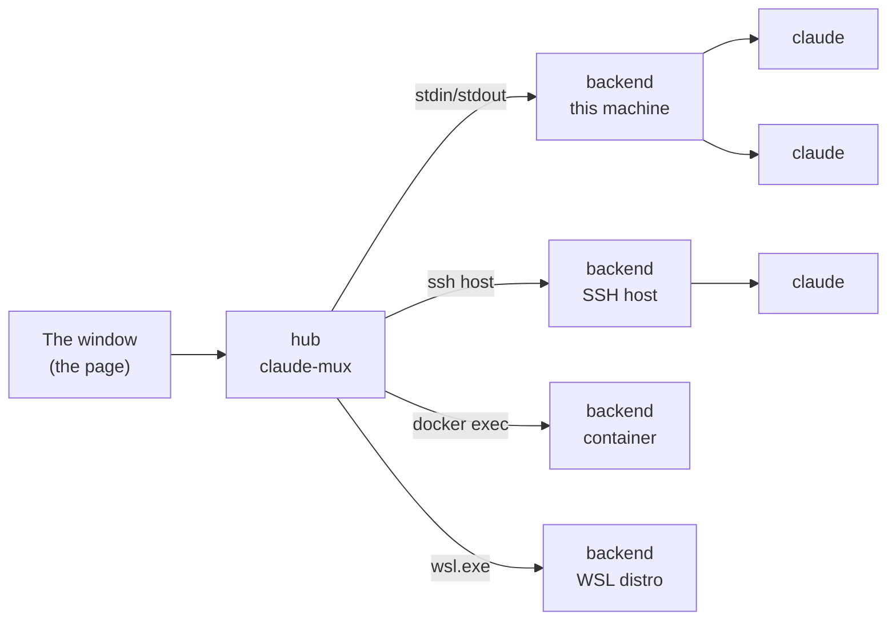
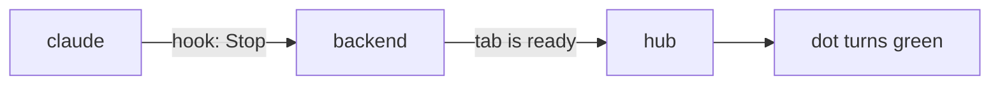

# claude-mux

One window for all your Claude Code sessions. Tabs on the left, the live
terminal on the right, and a dot on every tab that tells you whether that
claude is working, done, or waiting for you.

The tabs can run on this machine, on SSH hosts, in Docker containers and in
WSL, all in the same window. A tab stays until you close it: quit the app,
reboot, update, and every tab comes back with its conversation.

<picture>
  <source media="(prefers-color-scheme: light)" srcset="docs/redesign/screenshots/main-light.png">
  
</picture>

## How it works, in short

claude-mux is two programs.

- The **hub** is the app you start. It shows the window and remembers your
  environments and settings.
- A **backend** runs your tabs: one `claude` per tab, each in its own
  terminal. There is one backend per environment, and the hub starts it
  there: as its own child on this machine, or through `ssh`, `docker exec`
  or `wsl.exe` elsewhere. It talks to it over that one connection, with no
  ports opened anywhere.



You never install anything in an environment yourself. On connecting, the
hub checks what the machine is (`uname`), and copies the matching backend
there if it is missing.

**How the dots know.** claude-mux starts each claude with a small set of
[hooks](https://docs.claude.com/en/docs/claude-code/hooks). Claude Code runs
them on every event: a prompt sent, a tool used, a permission asked, a turn
finished. Each hook tells the backend, the backend tells the page, and the
dot changes.



**How tabs come back.** A backend lives only as long as its connection.
When the hub quits, or an SSH connection drops, the backend hangs up its
claudes, the way closing a terminal window does. It keeps the list of tabs.
On the next start it opens each tab again with `claude --resume`, so the
conversation continues. What was running inside the old process
(background tasks, watchers, dev servers) is gone. A tab can have a
startup message, sent as its first prompt each time its claude starts
again, to say so or to restart a watcher (New tab and Tab settings).

The details are in [docs/how-it-works.md](docs/how-it-works.md).

## Install

Download the hub for your machine from the
[latest release](https://github.com/askolesov/claude-mux/releases/latest).

| System | File | Notes |
|---|---|---|
| Mac (Apple silicon and Intel) | `claude-mux-mac.zip` | Unzip `claude-mux.app` into Applications. It isn't signed: the first time, right-click → Open, or System Settings › Privacy & Security › Open Anyway. |
| Windows | `claude-mux-windows-amd64.exe` | Unsigned too: SmartScreen wants More info → Run anyway. Needs WebView2, which Windows 11 has. Claude Code on Windows needs Git for Windows. |
| Linux | `claude-mux-linux-amd64`, `-arm64` | Needs WebKitGTK 4.1 (`libwebkit2gtk-4.1-0`). |

You need [Claude Code](https://docs.claude.com/en/docs/claude-code) in
each environment you use. If it isn't there, claude-mux offers to run the
official installer for you.

claude-mux updates itself. It checks GitHub once a day (Settings ›
Updates); **Update and restart** replaces the app and brings every tab
back.

## Using it

- **New tab**: the **+** at the top of the sidebar (⌥N) makes one next to
  the selected tab; right-click an environment or a group for one inside
  it. It asks for a name and a directory (Tab completes it, from that
  environment). The startup message and the `claude` arguments repeat your
  last tab; `--dangerously-skip-permissions` and `--chrome` are checkboxes.
- **The dot**:
  - blue: working
  - green: ready for your next prompt
  - amber with a ring: needs you (a permission prompt or a question)
  - hollow: exited, and Enter in its terminal resumes it

  A tab that finished while you weren't looking stays bold until you open
  it. The window title and the Dock icon count the tabs that wait.
- **Tab settings** (… above the terminal, ⌘I, or right-click a tab): its
  directory, startup message and arguments. Saving restarts its claude,
  and the conversation continues. A tab's name is claude's: type
  `/rename <name>` in the tab to change it.
- **Right-click** any row for what it can do. A tab: Tab settings,
  Duplicate, Move to…, Restart, Close. A group: New tab, New group,
  Rename, Collapse, Delete. An environment: New tab, New group,
  Reconnect, Environment settings, Remove. The Menu key or ⇧F10 opens it
  from the keyboard.
- **Groups** hold tabs and other groups, as deep as you like. Make one
  with ⇧⌥N (next to the selected tab) or from a right-click; it starts
  named "New group" for you to type over, and Esc takes it back. Fold
  groups and environments by their chevrons. Rename them with F2 or a
  double-click. Deleting a group moves what it held up a level; no tab is
  closed.
- **Moving**: drag a tab or a group onto a group to put it inside, or
  between rows. The line shows where it lands, and its left edge the
  level: drag left or right to change it. ⌘⇧↑/↓ moves the selected row
  within its group, and Move to… puts a tab in any group.
- **Tab rows** (Settings › Appearance): Detailed shows each tab's
  directory under its name, Compact only the name.
- **Environments**: **Connect environment**, under the last one, adds one.
  You can add:
  - an SSH host (it must accept your key without a password prompt)
  - a running Docker container
  - a WSL distro

  Drag their headers in the sidebar to reorder them.
- **Keys**:

  | Key | Does |
  |---|---|
  | ⌘K (Ctrl+K) | jump to a tab |
  | ⌥1–9 | go to tab 1–9 |
  | ⌥↑ / ⌥↓ | previous / next tab |
  | ⌥J | next tab that waits for you |
  | ⌥N | new tab next to this one |
  | ⇧⌥N | new group next to this one |
  | ⌘I | Tab settings |
  | ⌘W | close the tab (asks first) |
  | ⌘⇧↑ / ⌘⇧↓ | move a row up / down in its group |
  | ↑↓←→, Enter, F2, ⌫ | in the sidebar: move, fold, open, rename or delete a group |
  | Menu key, ⇧F10 | in the sidebar: the row's menu |
  | ⌘, | Settings |
  | ⇧↵ | newline in the prompt |

- **No window**: `claude-mux -headless -open` serves the page in your
  browser instead, until you stop it.

Everything claude-mux keeps is in `~/.claude-mux/`, in each environment:
`hub.json` on your machine, `backend.json` (the tabs) wherever tabs run.

## Building from source

Go 1.27 or newer. The hub's window needs cgo and the system web view.

```sh
scripts/restart.sh        # build the hub and every backend, restart a dev hub on :7777
go test ./...
scripts/macapp.sh v0.0.0 out   # build claude-mux.app
```

A development build installs the backends you built (`-backend-dir`)
instead of downloading them, and doesn't update itself. Releases are made by
pushing a `v*` tag; CI builds everything and publishes it.
