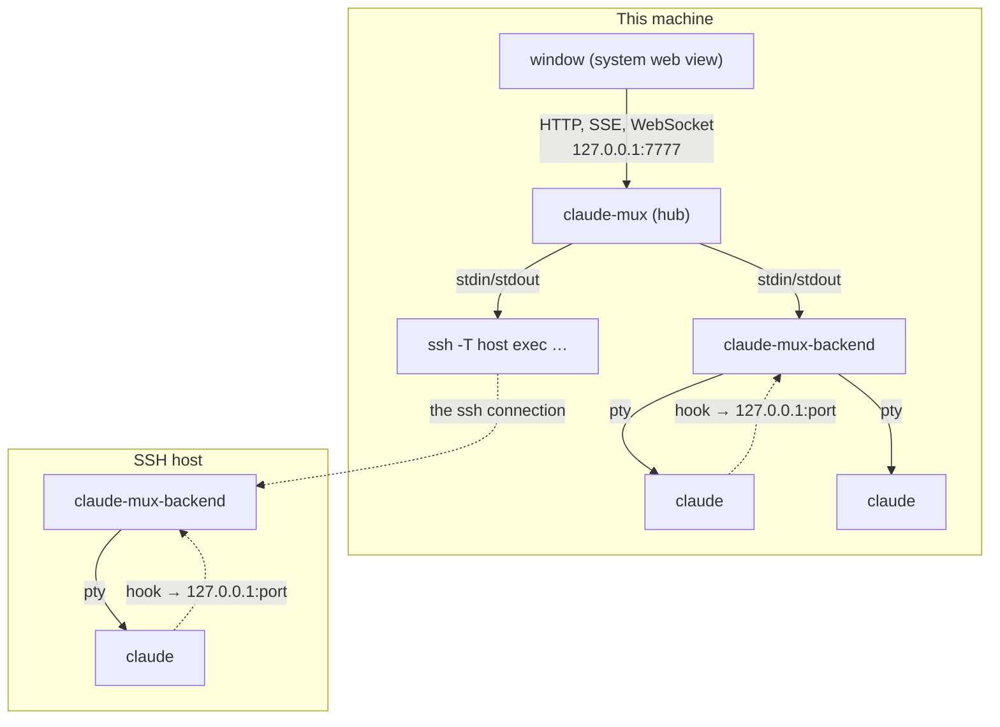
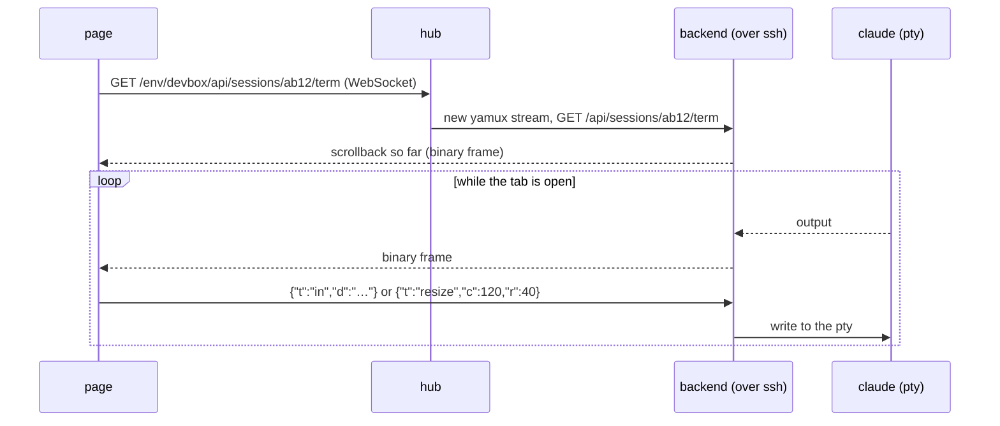
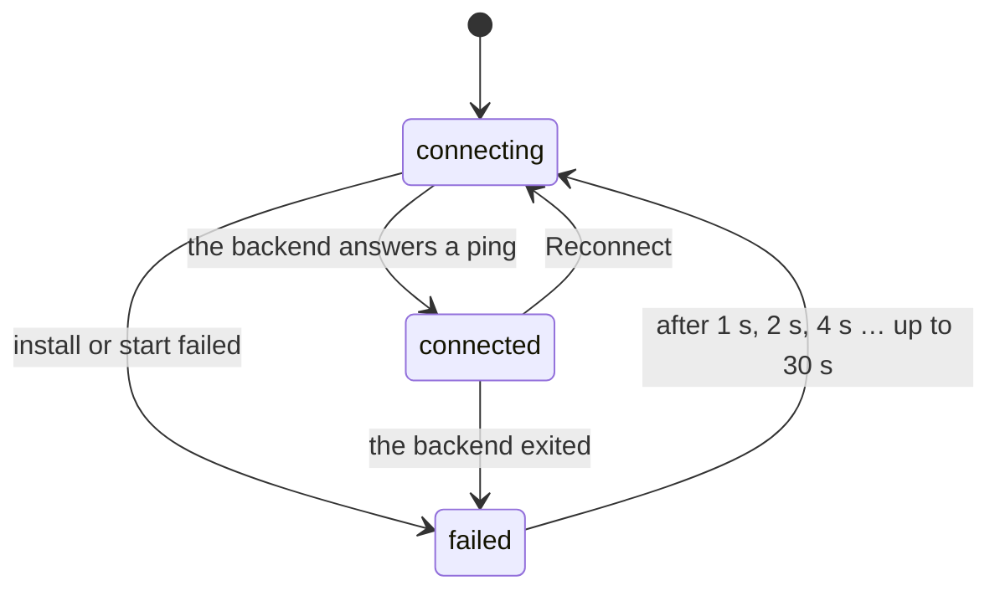
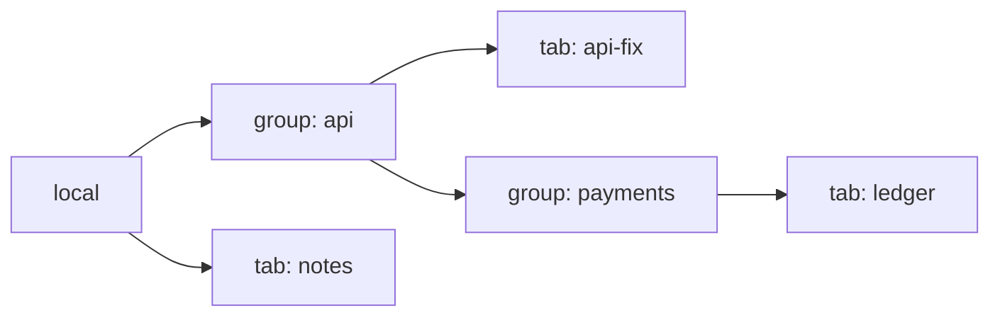
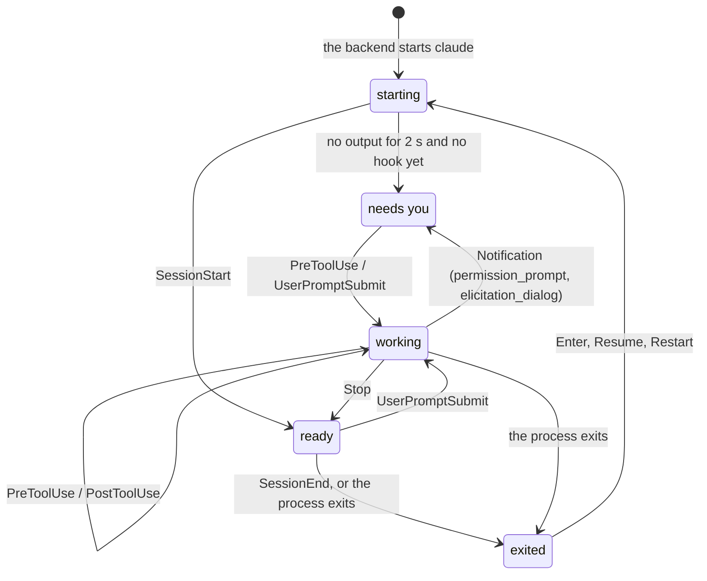

# How claude-mux works

This is the detailed version of the README's short tour, for people who
want to change the code or understand a failure. It follows a request from
the window down to a claude process, then covers each part in turn.

## Contents

1. [The pieces](#the-pieces)
2. [One connection per environment](#one-connection-per-environment)
3. [Connecting an environment](#connecting-an-environment)
4. [Tabs: the backend](#tabs-the-backend)
5. [Status from hooks](#status-from-hooks)
6. [Stopping, restarting, resuming](#stopping-restarting-resuming)
7. [The page](#the-page)
8. [The window](#the-window)
9. [Updates](#updates)
10. [Files and locks](#files-and-locks)
11. [Security](#security)
12. [Building and releasing](#building-and-releasing)
13. [Limits](#limits)

## The pieces

Two programs from one Go module, always of the same version.

| Program | Source | Job | Runs on |
|---|---|---|---|
| `claude-mux`, the hub | `cmd/hub`, `internal/hub` | the window and the page; the list of environments; starts and supervises one backend per environment and routes the page's requests to it; installs backends; updates itself | Mac, Windows, Linux |
| `claude-mux-backend` | `cmd/backend`, `internal/backend` | the tabs of the environment it runs in: a pty and a claude per tab, hooks, names, groups, `backend.json` | Mac, Windows, Linux; amd64 and arm64 |

The backend is pure Go (`CGO_ENABLED=0`), so one Linux file runs in any
distro or container. The hub needs cgo for its window. Built without cgo,
it opens the page in the browser instead.

```
cmd/hub/              main, the window (webview), Mac menus, notifications, Dock badge
cmd/backend/          main, and `claude-mux-backend hook`
internal/hub/         environments, connectors, backend install, routing, updater, hub.json
internal/hub/web/     the page: index.html, style.css, app.js, vendor/ (xterm.js, fonts)
internal/backend/     tabs (Manager, Session), ptys, hooks, resume messages, the API
internal/stream/      server-sent events and JSON-line progress, shared by both
internal/migrate/     the state files: versioned upgrade steps, atomic writes
internal/lockfile/    one process per state directory (flock / LockFileEx)
internal/sysproc/     starting helper processes: no console window on Windows, detached relaunch
assets/icon/          the icon: SVG sources, rendered PNGs, AppIcon.icns, Windows resources
scripts/              restart.sh (dev hub), check.sh (what CI checks), macapp.sh (the .app), icons.sh
```

Every process involved, when one SSH environment is added:



## One connection per environment

The hub starts each backend as a child process and talks to it over the
child's stdin and stdout, and nothing else. Locally that's the backend
itself. Elsewhere the child is the command that reaches the environment,
which runs the backend on the other side:

| Kind | The hub runs |
|---|---|
| `local` | `~/.claude-mux/bin/<version>/claude-mux-backend -state … -cwd … -resume …` |
| `ssh` | `ssh -T -o BatchMode=yes -o ServerAliveInterval=15 -o ServerAliveCountMax=3 <host> 'exec $HOME/.claude-mux/bin/<version>/claude-mux-backend -resume …'` |
| `docker` | `docker exec -i <container> sh -c 'exec …'` |
| `wsl` | `wsl.exe -d <distro> --exec sh -c 'exec …'` |

So a remote backend opens no port and needs no firewall rule. The only
requirement is the access you already have: your ssh key, your docker,
your WSL.

[yamux](https://github.com/hashicorp/yamux) splits that one pipe into
streams. The hub is the yamux client and the backend serves plain HTTP on
the yamux session as its listener. Each HTTP request, server-sent event
stream and terminal WebSocket is a stream of its own. A ping on the
session every 15 s gives the latency shown in the page.

The hub routes `/env/<name>/<path>` to that environment's backend with a
reverse proxy whose dialer opens a yamux stream (`Env.ServeHTTP`). The
backend never learns where it is mounted: it serves `/api/...` from its
root.



The hub's own API is `/hub/...`:

| Route | Does |
|---|---|
| `GET /hub/events` | SSE: version, platform, environments, update state, settings, on every change |
| `GET /hub/info` | version, the kinds of environment this machine can add, the state directory |
| `GET /hub/targets/:kind` | what can be added: hosts from `~/.ssh/config`, running containers, WSL distros |
| `POST /hub/environments`, `PUT /hub/environments/:name`, `DELETE /hub/environments/:name` | add, rename (not local), remove |
| `PUT /hub/environments/order` | reorder (local included) |
| `POST /hub/environments/:name/reconnect` | start that backend again |
| `PUT /hub/settings` | every hub setting at once (the page's own, too) |
| `POST /hub/update/check`, `/apply` | updates; apply streams its progress as JSON lines |
| `POST /hub/pick-folder` | the system's folder picker on this machine, for the local New tab |
| `POST /hub/open-log` | opens `hub.log` |

And a backend's, under `/env/<name>`:

| Route | Does |
|---|---|
| `GET /api/state`, `GET /api/events` | the tabs, claude's path and version, the default directory; SSE on every change |
| `POST /api/sessions` | new tab |
| `PUT /api/sessions/:id` | Tab settings: directory, args, startup message |
| `POST /api/groups`, `PUT /api/groups/:id`, `DELETE /api/groups/:id` | new group, rename, delete (its contents move up) |
| `PUT /api/nodes/:id/place` | move a tab or a group: `{parent, before \| after}` |
| `POST /api/sessions/:id/start`, `/restart`, `/seen`; `DELETE /api/sessions/:id` | lifecycle |
| `GET /api/sessions/:id/term` | the terminal, a WebSocket |
| `POST /api/sessions/:id/files` | a file dropped or pasted into the tab, as JSON with base64 data; answers its path |
| `GET /api/dirs?prefix=` | the directories a typed path could go on to, for New tab |
| `POST /api/claude/check`, `/api/claude/install` | look for claude again; run the official installer, streaming its output |

## Connecting an environment

`Env.Supervise` (`internal/hub/env.go`) keeps one backend running per
environment, from the hub's start until it quits or the environment is
removed.



While connecting, `step` says what is happening ("checking the platform",
"downloading the backend 12 / 22 MB", "copying the backend …", "starting
the backend"). The page shows it under the environment's name. A failure
shows the backend's last line on stderr, which is usually the reason (an
ssh error, a lock held by another hub). The pause resets once a backend
has run for a minute.

`Connectors.Prepare` (`connectors.go`) runs before each start of a remote
backend:

1. `uname -sm` in the environment gives its platform: `linux-amd64`,
   `linux-arm64`, `darwin-arm64` or `darwin-amd64`. Anything else, such as
   native Windows over SSH, has no backend build and fails here.
2. `Backends.Build` (`backends.go`) finds the build for that platform:
   - **A release hub** downloads `claude-mux-backend-<platform>` from the
     GitHub release of its own version. It checks it against that
     release's `checksums.txt` and keeps it in
     `~/.claude-mux/cache/<version>/`. A hub only ever runs backends of its
     own version, so the two always speak the same API.
   - **A development hub** (`-backend-dir`) takes the build from that
     directory and names its version `dev-<sha256 prefix>`, so a changed
     build installs again and an unchanged one never does.
3. `test -x ~/.claude-mux/bin/<version>/claude-mux-backend`. If it isn't
   there, the hub pipes the file through the same connection, `cat > ….tmp
   && chmod +x && mv`, then removes every other version under `bin/`. The
   environment needs no internet for this.
4. The start command: `exec <bin> -resume <base64url>` (the resume default
   from before v0.7, for upgrading an old `backend.json`; see Files).

The local backend is installed the same way, into this machine's
`~/.claude-mux/bin/<version>/`. It is always a fresh file renamed into
place, never one rewritten: macOS kills a binary whose code signature went
stale.

Once the backend answers its first ping, the environment is connected, and
the page opens that backend's event stream.

## Tabs: the backend

`internal/backend/manager.go` holds the tabs and the groups they sit in.

**The tree** (`tree.go`). An environment holds groups and tabs; a group
holds the same, to any depth; groups and tabs mix in one order. Each node
is stored flat, with its `parent` (a group's id, or none for the
environment) and an `order` key. The key is a fractional index: a base-62
fraction compared as a plain string, the same in Go and in the page. A move
gives one node a key between its new neighbours' and touches nothing else.
A group can't be moved into itself or anything inside it, and deleting one
moves its contents up into its place.



A group is `{id, name, parent, order}`. A tab is a `Session`
(`session.go`), with what is saved in `backend.json`:

| Field | |
|---|---|
| `id` | 8 hex characters, the tab's key |
| `name` | follows claude's own name for the session |
| `parent`, `order` | where it sits in the tree |
| `cwd`, `args` | where claude starts, and its extra arguments |
| `claudeSessionId` | the conversation the tab continues, from its hooks |
| `resume`, `resumeMessage` | its startup message: `custom` sends it, `off` doesn't (the text stays) |

And what lives only in memory: the status and since when, unseen, the git
branch of `cwd`, the pty process, and the last 1 MB of output. The output
is replayed to a terminal that connects, so switching tabs or reloading the
page loses nothing on screen.

Starting a tab runs:

```
claude [--resume <claudeSessionId>] --settings ~/.claude-mux/backend-hooks.json --name <name> <args…> [-- "<startup message>"]
```

in a pty (creack/pty; ConPTY through go-pty on Windows), 120×40 until the
page says its size. `--resume` is added only when claude has a transcript
for that session (`~/.claude/projects/*/<id>.jsonl`). A tab where nothing
was said yet starts fresh. The child's environment gets `CLAUDE_MUX_ID`,
`CLAUDE_MUX_HOOK`, `TERM=xterm-256color`, `COLORTERM=truecolor` and
`FORCE_HYPERLINK=1`. It loses the variables a running Claude Code sets for
its own children (`CLAUDECODE`, `CLAUDE_CODE_SESSION_ID`, …), so a backend
started from inside a claude session doesn't make its claudes take
themselves for subagents.

Three loops keep the tabs current:

- **Names**, every 5 s: `claude agents --json` lists the running claudes
  with their pids and names. A tab whose process has a new name takes it,
  so `/rename` in a tab renames it in the sidebar. The name goes back to
  claude as `--name` on the next start.
- **Branches**, every 10 s: `git -C <cwd> branch --show-current`.
- **Startup**, every second: a tab still starting that has printed
  nothing for 2 s is waiting on a prompt claude shows before any hook runs
  (trusting the folder, logging in), so it is marked as needing you.

claude itself is found on the PATH, then in `~/.local/bin` and
`~/.claude/local`, where the official installer puts it and which a
non-interactive ssh usually leaves off the PATH. If there is none, the
environment says so. **Install** runs `curl -fsSL
https://claude.ai/install.sh | bash` (on Windows `irm
https://claude.ai/install.ps1 | iex`) and streams its output to the page.
Then the tabs that couldn't start do.

## Status from hooks

Every claude a backend starts gets `--settings backend-hooks.json`, written
on each backend start. It runs `claude-mux-backend hook` on seven events.
The hook command reads the event's JSON from stdin and posts it to
`CLAUDE_MUX_HOOK`: the backend's hook port on `127.0.0.1`, a random port,
with a random token in the path that is new on every start, and the tab's
id. If the backend is gone, the hook does nothing and never fails claude's
event.



Reaching ready, needs you or exited marks the tab unseen until the page
shows it. The hook payload's `session_id` is kept as the tab's
`claudeSessionId`: that is how a tab knows which conversation to resume,
including after `/clear` starts a new one.

The page shows each status as a dot: blue working, green ready, amber with
a ring needs you, hollow exited or stopped. `stopped` is a tab the backend
loaded from `backend.json` but couldn't start yet, usually because claude
isn't installed.

## Stopping, restarting, resuming

The backend lives as long as its pipe to the hub. When the pipe closes,
because the hub quits, updates or reconnects it, or the ssh connection
drops:

1. the backend hangs up every claude: SIGHUP, what closing a terminal
   window sends (on Windows, closing the pseudo console)
2. it kills the ones still there after 3 s
3. it waits until all have exited and only then lets go of its lock. A
   new claude resuming a conversation whose old process still runs would
   fork the transcript.
4. it exits. The tabs stay in `backend.json`.

The next backend starts every tab again, with `--resume`. Restart in Tab
settings does the same for one tab: it hangs up its claude and starts it
again once it has exited.

**The startup message.** A resumed claude continues the conversation, but
whatever ran in its old process (background shells, watchers, dev servers)
is gone, and it doesn't know. A tab's startup message tells it, or restarts
the watcher, as the first prompt after `--`.

- Each tab has its own, set in New tab and Tab settings. New tab repeats
  the last tab's.
- It is never sent on a tab's first start, only when a conversation is
  resumed.
- Before v0.7 the hub kept one default for every tab. A tab that followed
  it got it as its own on upgrade.

**Names.** A tab gets its name in New tab (the folder's, if left empty),
and claude gets it with `--name`. After that the name is claude's:
`/rename` typed in the tab is the only way to change it, and the backend
follows it from `claude agents --json`. Groups and environments rename in
the sidebar.

## The page

`internal/hub/web/` is plain HTML, CSS and JavaScript, embedded in the hub
with nothing to build. xterm.js, its fit and web-links addons, Inter and
JetBrains Mono are in `vendor/`, so the page needs no internet.

- It holds one `EventSource` on `/hub/events`, and one on each connected
  environment's `/api/events`. Every event is the whole state, not a diff.
  The tab list is rebuilt from it each time.
- A terminal is created the first time its tab is opened and kept, hidden,
  after that. Each has its own WebSocket, which reconnects with a growing
  pause.
- A file dropped or pasted onto a terminal gets its path typed in, as a
  terminal does for a dropped file, and claude attaches it from the path.
  A page never learns where a file is, so:
  - a local tab in the Mac app gets the file where it is: the page asks
    the hub (`cmuxPaths`), which reads the paths from the drag pasteboard,
    or for a file copied in Finder from the clipboard.
  - anything else (a tab on another machine, a screenshot that is only on
    the clipboard, a browser, Windows, Linux) is sent to the tab's backend
    (`POST /api/sessions/:id/files`) and kept in `files/<tab id>/` until
    the tab is closed; the path typed in is that copy's.
- Settings that are the page's own (themes, font size, tab rows,
  notifications, the last tab's options for New tab) are kept by the hub in
  `hub.json` as `settings.page`, so the app's window and a browser share
  them. They have a `version` and upgrade steps of their own
  (`PAGE_STEPS` in `app.js`). A copy in `localStorage` paints the first
  frame. Folded groups, the sidebar width and the last directory per
  environment stay per browser.
- The sidebar is an ARIA tree. Rows are `treeitem`s with `aria-level`, and
  containers have `aria-expanded`. The keys are ↑↓←→, Enter, Home/End, F2
  to rename a group or an environment, ⌫ to delete a group, the Menu key or
  ⇧F10 for the row's menu, and type-ahead. Drag-and-drop works out the
  target depth from the pointer's x.
- New tab, Tab settings, Settings and Environment settings are one family
  of 440 px modals. New tab's directory completes from the environment's
  backend (`/api/dirs`); its folder button, local only, asks the hub for
  the system picker (`osascript`, a PowerShell FolderBrowserDialog, or
  zenity / kdialog).
- When `/hub/events` reports a different hub version (after an update),
  the page reloads.
- The app's window is a bare web view, which answers `confirm()` and
  `alert()` without showing anything. The page uses its own dialogs
  everywhere.

## The window

`cmd/hub/window.go` shows the page with
[webview_go](https://github.com/webview/webview_go): WKWebView on a Mac,
WebView2 on Windows, WebKitGTK on Linux.

- **More windows**: New window (⌘N) opens another window on the same
  page (`cmuxNewWindow`). On a Mac it is another web view in the app. On
  Windows and Linux, where a third web view in one process stayed blank,
  the hub starts its own program again (`POST /hub/windows`), which finds
  the hub running and shows its page; the hub goes on until the last of
  these windows closes. Every window is a page of its own,
  with its own selected tab (`sessionStorage`); they all show the same
  backends live. They find each other on a `BroadcastChannel` and are
  numbered in the order they were opened, 1 to N with no gaps, shown as
  "2/3" while more than one is open; the first to see a status change
  sends its notification. In a browser, New
  window opens a browser window.
- Closing the last window quits the hub; Quit (⌘Q) stops them all. The
  backends shut down the same way either way.

- **Mac**: `menu_darwin.go` adds the menus a Mac app needs (without an Edit
  menu a web view takes no ⌘C or ⌘V), and `badge` sets the Dock count.
  Notifications go through `osascript`, because a bare WKWebView has no
  Notification API. The page calls both through bindings, `cmuxNotify` and
  `cmuxBadge`.
- **Links** clicked in a terminal go to the hub through the `cmuxOpen`
  binding, which opens http and https links in the default browser: the
  web view opens no windows of its own. Tabs start claude with
  `FORCE_HYPERLINK=1`, so it marks its links as terminal hyperlinks (OSC
  8): a link claude breaks over two lines is still one link.
- **Started from Finder or Explorer** (no `TERM`), the hub logs to
  `~/.claude-mux/hub.log`. It takes the login shell's environment (`$SHELL
  -ilc env`), so local tabs see the PATH a terminal would, and it defaults
  new tabs to the home directory.
- **A second start** with the same state directory finds `hub.lock` held,
  reads the running hub's address from it, and opens a window onto that
  hub. With `-headless` it says it's already running and exits.

## Updates

`internal/hub/update.go`. A release hub asks the GitHub API for the latest
release:

- when it starts, then every hour, if checks are on (Settings › Updates)
  and the last one was more than "every N days" ago
- on Check now

A newer one shows in the sidebar and in Settings › Updates, with one
notification per version. Development builds never check.

**Update and restart**:

1. downloads this platform's file of the release and checks it against
   `checksums.txt`
2. puts it in place of the running hub:
   - **Mac**: `claude-mux-mac.zip` is unzipped with `ditto`, and the whole
     `.app` bundle is swapped (staged as `.app.new`, the old one moved to
     `.app.old` and removed). An app still running from macOS's read-only
     download copy (`AppTranslocation`) can't update: it says to move it to
     Applications first.
   - **Windows**: a running exe can't be overwritten but can be renamed, so
     it moves aside to `.old`, which the next start removes.
   - **Linux**: a rename over the binary.
3. stops: every backend hangs up its tabs, the server closes, the lock is
   released
4. starts the new hub detached, with the same arguments (`open -n` for the
   app). It resumes every tab, and each environment gets the new version's
   backend when it connects.

## Files and locks

Both state files carry a `version`. Every change to a file's shape is a
numbered step in that file's migrations (`internal/backend/migrations.go`,
`internal/hub/migrations.go`), run by `internal/migrate`:

- Steps upgrade the raw JSON one version at a time, so a file from any
  release reads in the current one.
- Before writing an upgraded file, the old one is kept as
  `<file>.v<version>.bak`.
- Every write is a new file renamed over the old one, so a crash mid-write
  leaves the old file whole.
- A file from a newer release is refused, never overwritten.
- Steps are never removed or changed once released, and each has a test
  with a file of the version before it.

Version 1 is everything up to v0.6:
- **backend.json:** `state.json` renamed; a tab's `startupMessage` became
  its resume message; group names became group nodes.
- **hub.json:** v0.3's flat fields moved under `settings` and `update`;
  `environments.json` merged in.

Version 2 is v0.7, where each tab has its own startup message:
- **hub.json:** `settings.resume`, the default for every tab, moved to the
  top level as `resumeDefault`. The hub keeps it only to pass to backends
  (`-resume`) that haven't upgraded yet.
- **backend.json:** a tab that followed the default (`resume: ""`) got the
  default's text as its own (`custom`), or none (`off`) if it was off.

Everything is in `~/.claude-mux/` (`-state` moves it). On this machine:

| File | Written by | Holds |
|---|---|---|
| `hub.json` | hub | `version`, `settings` (update check, `page`), `environments` in sidebar order with `local` among them, `update` (last check), `resumeDefault` (see above) |
| `hub.lock` | hub | its pid and address, locked while it runs |
| `hub.log` | hub | its output and its backends', when started from Finder or Explorer |
| `cache/<version>/` | hub | downloaded backend builds |
| `update/` | hub | an update being downloaded |

In every environment, this machine included:

| File | Written by | Holds |
|---|---|---|
| `backend.json` | backend | the tabs and groups (`version`, `sessions`, `groups`) |
| `backend-hooks.json` | backend | the hooks settings passed to every claude |
| `backend.lock` | backend | its pid, locked while it runs |
| `files/<tab id>/` | backend | files dropped or pasted into a tab, until it is closed |
| `bin/<version>/claude-mux-backend` | hub | the installed backend; other versions are removed |

The locks (`internal/lockfile`) are the operating system's (flock,
LockFileEx), so they go with the process however it ends.

- **One hub per state directory.** A second hub would start every
  environment's backends again and race on `hub.json`.
- **One backend per environment.** Two backends would both resume every
  tab, forking each conversation. If a hub with other state reaches the
  same machine or container, its backend fails with "in use by another
  claude-mux (pid …)". It keeps retrying and connects once the first lets
  go.

## Security

Anything that reaches a backend can start processes as you, so:

- the hub listens on loopback only and refuses another address
- `localOnly` (`hub.go`) rejects these requests (tested in `hub_test.go`):
  - a `Host` other than `127.0.0.1` or `localhost` (DNS rebinding)
  - an `Origin` other than the page's own
  - a write whose body isn't JSON (a cross-site form post)
- terminal WebSockets keep gorilla's default origin check
- backends listen on no port for the API. The hook port is loopback, and
  needs a token that is new on every start, so another user of a shared
  host can't post statuses.
- remote environments are reached only with your own ssh, docker or WSL,
  with `BatchMode=yes`, so a host that wants a password fails instead of
  waiting for one
- downloaded backends and updates are checked against the release's
  SHA-256 checksums

The release apps are not code-signed. The Mac app is signed ad hoc, which
Apple silicon requires to run at all.

## Building and releasing

`scripts/restart.sh` is the development loop:

1. builds the hub, plus backends for darwin and linux on amd64 and arm64,
   into `~/.claude-mux/dev`
2. stops the hub on :7777
3. starts a headless one with `-backend-dir`
4. waits until the tabs are back

It shares `~/.claude-mux` with the installed app, so quit the app first.
Run it from a regular terminal, not from a tab: the restart hangs that tab
up too.

CI (`.github/workflows/ci.yml`) runs on every push to main and every PR,
and `scripts/check.sh` runs the same checks locally:

| Job | Checks |
|---|---|
| go (ubuntu) | gofmt; vet for linux, windows and darwin; the tests, and the internals again with `-race` |
| lint (ubuntu) | golangci-lint (`.golangci.yml`) for linux and windows; ESLint on the page (`eslint.config.js`) |
| mac | the hub with its window (cgo): vet, build, tests with `-race` |
| windows | the hub with its window (cgo, WebView2): vet, build, tests |

Dependabot (`.github/dependabot.yml`) proposes updates to the Go modules,
the actions and ESLint weekly, one PR each. ESLint is the only Node in the
repo (`package.json`); nothing of it is built or shipped, and `go.mod`
ignores `node_modules`.

A `v*` tag runs `release.yml`:

| Job | Builds |
|---|---|
| backends (ubuntu) | every backend, cross-compiled without cgo; the Windows arm64 hub, without a window |
| mac | a universal (arm64 + amd64) `claude-mux.app`, `scripts/macapp.sh`, zipped |
| windows | the amd64 hub with its window (`-H=windowsgui`), icon from `cmd/hub/rsrc_windows_*.syso` |
| linux (amd64, arm64) | the hub with its window, against WebKitGTK 4.1 |
| release | `checksums.txt` and the GitHub release |

`scripts/icons.sh` regenerates every icon file from `assets/icon/svg/`.

## Limits

- Tabs live in their backend, and the backend lives as long as its
  connection. A dropped ssh connection hangs those tabs up; they resume on
  reconnect, but what ran inside them is gone.
- No backend for native Windows over SSH. On Windows, use the local
  environment or WSL.
- Each environment has its own claude, login and `~/.claude`. A
  conversation can't move between environments.
- Only claudes claude-mux started are shown. claude in other terminals is
  left alone.
- Claude Code picks its own colours (`/theme`). With a light terminal
  theme, its light theme reads better.
