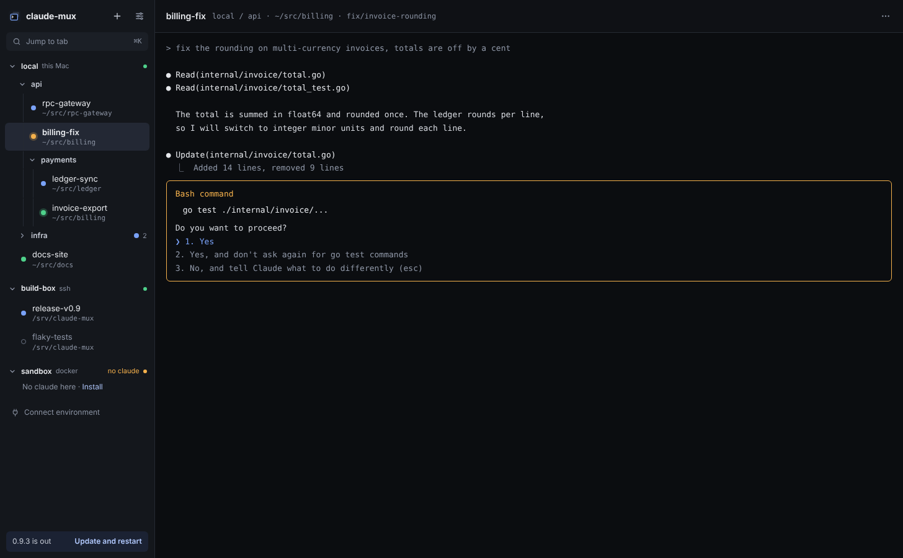
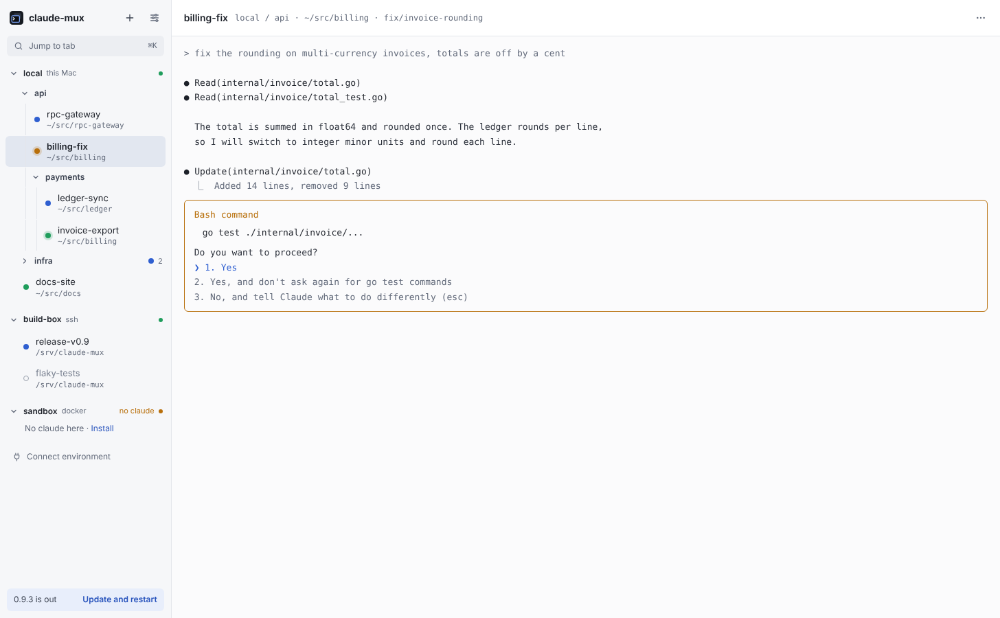

# UI redesign (v4)

The page stays a simple tool: tabs, the live terminal, and nothing that
says the same thing twice. This is the concept behind the mockups in
[`mockups/`](mockups/) and on the design canvas
(https://claude.ai/artifact/6b129ec8-cb4b-4863-8820-b70f02942f5a).

## Principles

- **One signal per fact.** A tab's state is its dot. No pill, badge or
  label repeats it.
- **Details live where they are asked for.** Branch, directory, session id,
  args are in the header line or in Tab settings, not on every row.
- **Settings for the window, Tab settings for a tab.** No right-click-only
  features: everything in the context menu also has a visible place.
- Two themes, dark and light (Auto follows the system); one accent; Inter
  for the UI, JetBrains Mono for the terminal and paths.

## Icon

Stacked terminals: three windows, the front one with a `>_` prompt and an
accent outline. Files in [`assets/icon/svg/`](../../assets/icon/svg/):

- `icon.svg`: the app icon (`.app`, `.exe`, release page), dark tile. Used
  in both themes, so the app looks the same everywhere.
- `icon-light.svg`: light tile, for places that need one (light docs,
  README badges).
- `icon-small.svg`: 16–24 px (favicon, sidebar mark, window title): two
  layers and heavier strokes so it stays readable.

The favicon keeps the waiting count the page already draws on it.

## Themes

The same names in both; mockup `V4Main.dc.html` takes `theme`
(`dark` / `light`), `V4Light.dc.html` shows light.

| Token | Dark | Light | Used for |
|---|---|---|---|
| `bg` | `#0F1115` | `#FFFFFF` | page, header |
| `panel` | `#14171C` | `#F6F7F9` | sidebar |
| `line` | `#252A33` | `#E3E6EB` | borders |
| `field` | `#1B1F26` | `#ECEEF2` | inputs, Jump field |
| `sel` | `#232834` | `#E2E7F0` | selected tab |
| `term` | `#0B0D10` | `#FBFBFC` | terminal background |
| `text` | `#E6E8EC` | `#1D2129` | main text |
| `text2` | `#C4C9D3` | `#3D4452` | secondary text |
| `muted` | `#8A92A2` | `#626A7A` | labels, paths |
| `accent` | `#7AA2F7` | `#2F5FD0` | links, primary button, focus |
| `accentSoft` | `#1B2233` | `#E8EEFB` | update notice |
| `working` | `#7AA2F7` | `#2F5FD0` | status dot |
| `ready` | `#4FD18B` | `#1F9D5C` | status dot, healthy env |
| `needs` | `#F5B14C` | `#B86F0A` | status dot, env problem |
| `exited` | `#6B7383` | `#9AA1AD` | hollow ring |

The light status colours are darker so the dots stay readable on white. The
terminal theme is separate (Settings › Appearance) and defaults to matching
the page.

## Main window

Mockups: `V4Main.dc.html` (detailed rows), `V4Compact.dc.html` (compact
rows), `V4Light.dc.html` (light theme).

Tabs live in the left sidebar only. There is no tabs-on-top layout: a
terminal for claude rarely needs the full width, the height matters more,
and the tree (environments, nested groups, two-line rows) doesn't fit a
horizontal strip. One layout, done well, instead of two.

**Sidebar**

- Top row: logo mark, `claude-mux`, **+** (new tab, ⌥N), settings. The
  sidebar can be dragged wider or narrower; it never collapses to icons,
  because without names you can't tell the sessions apart.
- **Jump to tab ⌘K**: the only search; opens the switcher.
- **Environment header**: a collapse chevron, the name (semibold, main
  text colour), the kind in muted text (`this Mac`, `ssh`, `docker`), then
  on the right the health dot (green connected, amber problem; latency and
  details on hover). A state word appears only when something is
  wrong (`no claude`, `disconnected`); an environment without claude says
  *No claude here · Install*.
- **The tree** (see *Tab tree* below): environments at the top, then
  groups and tabs, groups nesting to any depth. Groups show a chevron and
  their name; tabs a status dot.
- **Tab row**: the status dot, then two lines: the name (plus ↻ when it has
  a startup message) and the directory in small mono. Nothing else.
  Settings › Appearance › *Tab rows* switches between **Detailed** (two
  lines, the default) and **Compact** (name only, one line); mockup
  `V4Compact.dc.html`.
- **Connect environment** is a plain muted row (plug icon) after the last
  environment: adding an environment extends the list it belongs to.
- At the bottom, only when a release is out: *0.9.3 is out · Update and
  restart*.

**Above the terminal**: the tab's name, then
`env / group / subgroup · directory · branch` in mono, and **…**, which opens Tab
settings. No status pill: the dot already says it.

**Terminal**: fills the whole area under that line, edge to edge, on the
`term` background. No inset, border or rounded frame.

## Tab tree

Mockups: `V4Main.dc.html`, `V4Tree.dc.html` (right-click menu on a group)
and `V4NewGroup.dc.html` (a new group being named).

**Model.** Three kinds of node:

| Node | Lives in | Holds |
|---|---|---|
| Environment | the root | groups and tabs |
| Group | an environment or a group | groups and tabs |
| Tab | an environment or a group | nothing (a leaf) |

Groups and tabs mix in one user-defined order (a group isn't forced above
or below the tabs). Stored flat, one record per node:
`{id, kind, parent, order, name, …}`, with `order` a sortable key
(fractional index, e.g. `"a0"`, `"a0V"`), so a move or reorder rewrites one
record. The sidebar builds the tree from `parent`. Moving a group moves
everything in it. Today's `group` string on a tab becomes a group node
once, on upgrade.

**Rows.** One shape per kind, the same at every depth:

- Environment: chevron · name · kind · health dot (a state word only when
  something is wrong)
- Group: chevron · name (collapsed: also the most urgent dot inside and
  the tab count)
- Tab: status dot · name / directory

Each level indents 16 px, with a thin guide line under each group's
chevron so deep tabs still show where they belong.

**Adding.** No + on rows: the tree stays a list of names. New nodes come
from the same three places desktop trees use (Finder, VS Code, Xcode):

- **The sidebar's + (⌥N)** creates a new tab right where you are: in the
  same environment and group as the current tab, just below it. It has no
  picker on purpose; this is the everyday case and needs no aiming. To
  create somewhere else, right-click that environment or group.
- **Right-click** (or the Menu key / ⇧F10) on any row opens a context menu:
  - environment: *New tab, New group* · *Reconnect, Environment settings…*
    · *Remove environment*
  - group: *New tab, New group* · *Rename (F2), Collapse* · *Delete group*
  - tab: *Tab settings… (⌘I), Rename, Duplicate, Move to…* · *Restart,
    Close tab (⌘W)*

  *New tab* and *New group* there create inside the row you clicked (for a
  tab: next to it, in its group). ⇧⌥N is *New group* next to the selection.
- **New tab** opens the New tab dialog already aimed at that place:
  environment and group filled in, directory from the last tab started
  there (else the environment's default), arguments from the defaults.
  Enter starts it; the tab appears selected, its terminal open.
- **New group** doesn't open a dialog: a group with only a name is named in
  place, like a new folder in Finder or VS Code. The row appears at the end
  of that container with *New group* selected in an inline field; Enter
  keeps it, Esc removes it. Mockup `V4NewGroup.dc.html`; the context menu
  is in `V4Tree.dc.html`.

**Collapsing.** The chevron (or ←/→) collapses a container. A collapsed
group keeps one summary: the most urgent status inside (needs you >
finished unseen > working > ready > exited) and how many tabs it holds,
so nothing waiting gets hidden. Collapse state is kept per browser.

**Moving.** Drag any tab or group:

- onto a group or environment: into it, at the end;
- between rows: a line shows the drop point, and its left edge shows the
  depth it lands at (drag left or right to go up or down a level);
- a group can't go into itself or its own descendants.

Without a mouse: Tab settings › Group (pick any container), and ⌘⇧↑/↓ to
move within the parent.

**Other actions** (right-click, or the same keys in the tree):
rename (F2, or double-click a group), delete group (its contents move up to
the parent; no tab is ever closed by deleting a group), close tab (⌘W,
asks first).

**Keyboard and accessibility.** The sidebar is an ARIA `tree`; rows are
`treeitem`s with `aria-level` and, for containers, `aria-expanded`. ↑/↓
move, → expands or steps into, ← collapses or steps out to the parent,
Enter opens a tab, Home/End jump, typing a name jumps to it.

**Depth.** Any depth is allowed; past three group levels the indent stops
growing and only the guides show the depth, so names keep their width.

## Status

| State | Dot |
|---|---|
| Working | blue `#7AA2F7` |
| Ready, seen | green `#4FD18B` |
| Ready, **not seen yet** (claude finished while you looked elsewhere) | green with a soft green ring |
| Needs you (permission, question) | amber `#F5B14C` with a soft amber ring |
| Exited | hollow grey ring, grey name |

One dot, one rule: **a ring means "look at me"**. Amber when claude waits
for you, green when it finished and you haven't seen the result. Opening
the tab clears the green ring. Names are not bolded for status; only the
selected tab is. A collapsed group shows the dot (and ring) of its most
urgent tab.

The selected tab has a filled row background. The window title still counts
what waits: `(2) claude-mux`.

## Dialogs

New tab, Tab settings and Settings are one family: a modal over the
window with the same header (title, muted subtitle), the same field style
and the same footer. No boxes around groups and no lines between rows;
nothing that isn't needed is shown by default. No separate screens.

### New tab

Mockup: `V4NewTab.dc.html`. From the sidebar's + (⌥N) or *New tab* in a
context menu. It asks for two things:

- **Name**, first and focused; empty, with the folder name as placeholder;
  left empty, the tab is named after the folder (claude can rename it
  later, `/rename`).
- **Directory**, prefilled with the last directory a tab was started in
  **in that environment** (most people start every claude in one folder,
  locally or in a codespace). Typing completes paths from that
  environment's backend, like Tab in a shell, so it works the same over
  SSH, Docker and WSL. The folder button opens the system folder picker,
  shown for *this Mac* (or Windows/Linux) only.

The **group isn't asked**: it comes from where you clicked (the header
says *in local / api / payments*). The sidebar + puts it next to the
current tab, in the same environment and group.

Below, two folded rows, both closed by default:

- **Startup message**, a switch; on, a text box appears.
- **Arguments**, a disclosure whose summary shows what will be used
  (`skip permissions · chrome`). Open: one text field for anything extra,
  and under it two checkboxes, `--dangerously-skip-permissions` and
  `--chrome`. A checkbox disappears if its flag is typed in the field.

**Everything below Name repeats the last tab you started**: same switches,
same text, same checkboxes, custom or not. The very first time: no startup
message, both checkboxes on. The footer says *Same options as your last
tab*; *Cancel*, *Start* (Enter).

### Tab settings

Mockup: `V4TabSettings.dc.html`. From **…** in the header, *Tab settings…*
in the context menu, or ⌘I. The same form with the tab's values; header:
the name, then `env / group · session id`.

Name changes apply at once. Directory, startup message and arguments only
take effect when claude restarts, so changing any of them shows a notice
(*Saving restarts claude in this tab. The conversation continues where it
was.*) and the button becomes *Save and restart*. *Close tab* sits on the
left, in red. Moving to another group is done in the tree (drag, or *Move
to…*), not here.

### Settings

Mockup: `V4Settings.dc.html`. The gear in the sidebar, or ⌘,. A modal
with short sections: a small heading each and a thin line between
sections, none between rows. One row per setting:

- **Appearance**: Theme (Auto / Light / Dark), Terminal colours, Terminal
  font size, Tab rows (Detailed / Compact).
- **Tabs**: Ask before closing a tab.
- **Notifications**: When a tab needs me, When a tab finishes, Only while I
  am in another window.
- **Updates**, two rows: *Check every [N] days* with the on/off switch at
  the end (the field greys out when off); then the current version, *checked
  today at 14:20* and a small refresh icon to check now, with *Update to
  0.9.3* on the right only when a release is out (it restarts the app).
- A fixed footer: state folder and *Open log*.

Environments are managed in the tree (right-click an environment; *Connect
environment* under the last one), not here. New-tab defaults aren't here
either: new tabs repeat the last one.

## Jump (⌘K)

Mockup: `V4Jump.dc.html`. Fuzzy search over tabs, waiting tabs first,
then a few actions (New tab, New group, Tab settings, Settings). ↑↓ move,
↵ open, esc closes.

## Not now

- **Split view** (two terminals side by side): later.
- **Tabs on top**: dropped on purpose (see *Main window*). If it ever
  comes back, it would be a flat strip with one level of Chrome-style
  group chips; the data model doesn't change.
- Details side panel, filter chips, per-row branch lines, ⌥ number hints and
  the bottom status bar were tried and dropped as noise.
- Versions 2 (Photoshop-style) and 3 (VS Code-style) were tried and
  dropped; v4 is v1 with the noise taken out.

## The mockup files

`mockups/*.dc.html` are artboards of the design canvas; they need the
canvas runtime (`support.js`), so open them on the canvas
(https://claude.ai/artifact/6b129ec8-cb4b-4863-8820-b70f02942f5a) rather than
in a browser. `V4Main` is the window; the others import it with props
(`theme`, `rows`, `contextMenu`, `newGroupIn`, `activeTab`) or draw a dialog
over it. The icon files are in `assets/icon/svg/`.
